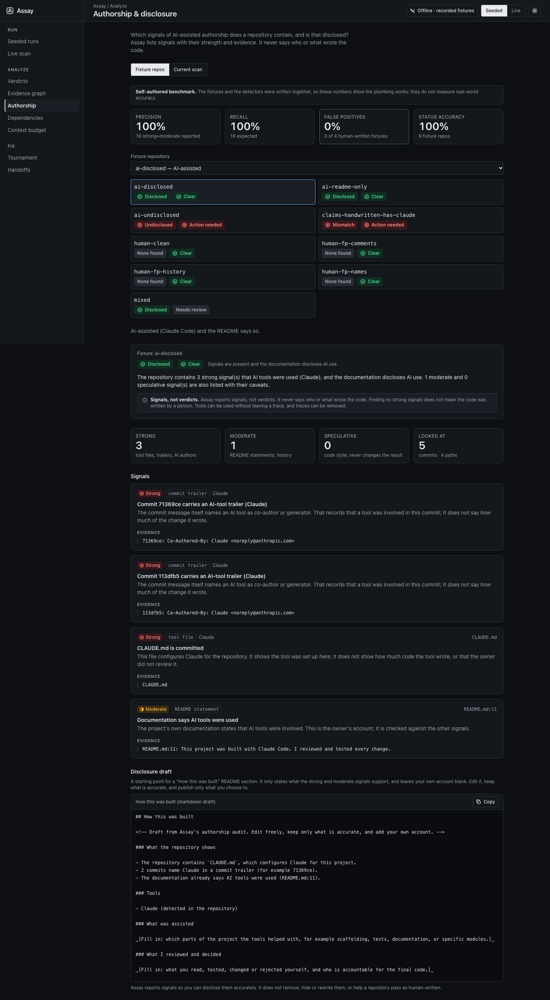

# Assay

Assay checks code that was written quickly, with or without AI help. It finds invented APIs, docs that disagree with the code, tests that prove nothing, and dependencies that don't exist. Each finding has a confidence label (confirmed, likely or speculative), and suggested fixes are tried on a copy of the code before they are offered. It runs offline by default and only contacts GitHub, npm and PyPI.


## What it checks

| Check | Finds |
|-------|-------|
| Hallucination | Invented stdlib or builtin APIs, imports of names or files that don't exist |
| Spec drift | Constants and function signatures that disagree with a spec document |
| Test theater | Tests with no assertions, tautologies, skipped tests, tests that mock the thing under test |
| Phantom dependency | Imports no manifest declares, packages missing from npm or PyPI, typosquats |
| Authorship | Signs that AI tools were used in a repo and whether the README says so (see below) |

## Run it

```bash
pnpm install
pnpm dev          # web UI at http://localhost:3000
pnpm test         # no network or API key needed
pnpm eval         # run the built-in benchmarks
pnpm mcp          # MCP server over stdio
pnpm authorship . # authorship check of a local repo (add --draft for a disclosure draft)
```

Set `GITHUB_TOKEN` to raise GitHub rate limits for live scans. Set `ASSAY_OFFLINE=1` to skip registry lookups.

## Screenshots

| Verdicts | Authorship |
|----------|------------|
|  |  |

## Use it from an AI tool (MCP)

```json
{
  "mcpServers": {
    "assay": {
      "command": "pnpm",
      "args": ["--silent", "--dir", "/absolute/path/to/assay-app", "mcp"]
    }
  }
}
```

Tools: `assay_review`, `assay_fix`, `assay_score_patch`, `assay_handoff`, `assay_eval`, `assay_check_deps`, `assay_check_authorship`.

## How it works

A scan reads a bundled demo, a local folder or a GitHub repo or pull request. The five checks run, a judge removes duplicate findings and assigns labels, and the results appear in the UI, over MCP and on the command line. For each finding, a patch tournament proposes fixes, applies each to a temporary copy, re-runs the review and scores the result. A patch that doesn't apply is rejected. See [docs/ARCHITECTURE.md](docs/ARCHITECTURE.md) for the code layout.

**Phantom dependencies.** Assay reads imports from JS/TS and Python files and compares them with the project's manifests and lockfiles. For anything undeclared it asks the npm or PyPI registry (or recorded fixtures offline). A package that doesn't exist is confirmed. A name close to a popular package is flagged as a possible typosquat.

**Authorship.** Assay reports signals, never a verdict: AI-tool trailers in commits, committed tool files such as `CLAUDE.md`, and README statements about how the project was built. Style-based signals are shown as speculative and never change the result. It checks whether the README discloses what the signals suggest and drafts a "How this was built" section for the owner to edit. It has no mode that hides or removes signals.

## Limits

- The benchmarks are small and written together with the checks, so a perfect score shows the pipeline works, not real-world accuracy.
- The checks are heuristics, not parsers or type checkers. Expect misses and false positives.
- Finding no AI signals is not proof a human wrote the code.
- The popular-package lists used for typosquat hints are hand-made snapshots.
- Unauthenticated GitHub allows 60 requests an hour, so large live scans need `GITHUB_TOKEN`.

## How this was built

This project was built with Claude Code, an AI coding assistant, working from my specifications in stages that I reviewed.

