# Assay

Assay is a local tool for checking code that was written quickly, with help or without: it looks for hallucinated APIs, spec drift, test theater and phantom or typosquatted dependencies, and it audits a repository for the signs of AI tool use that its owner may want to disclose, reporting each as a signal with its evidence and strength rather than a verdict. Every finding carries a confidence label (confirmed, likely or speculative), candidate fixes are tried in a throwaway directory before they are suggested, and everything is available in a web UI, over MCP, and from the command line. It runs offline by default and only ever talks to GitHub and the two package registries.

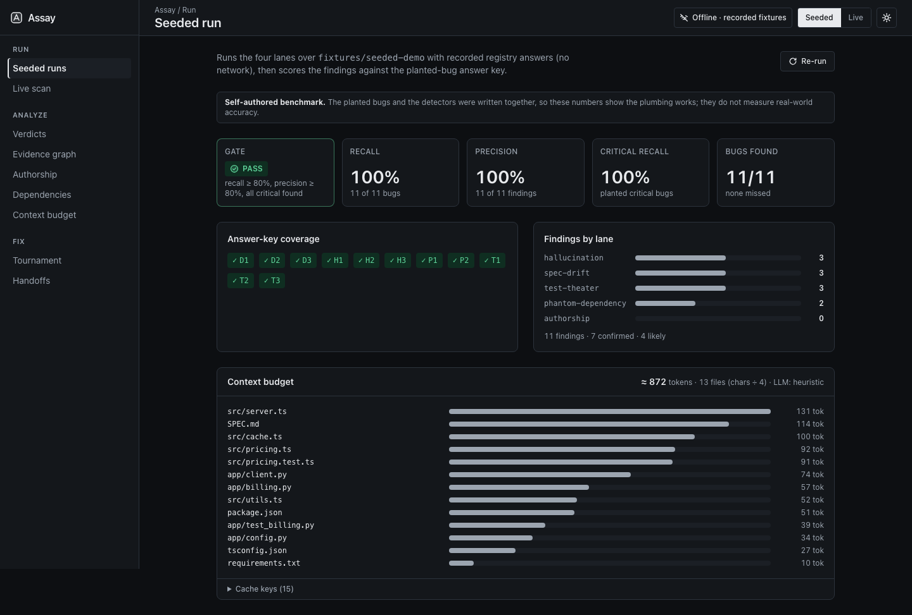

## What it does

| Lane | Looks for |
|------|-----------|
| Hallucination | Invented stdlib/builtin APIs, named imports a local module doesn't export, imports of missing files |
| Spec drift | Constants and function signatures that disagree with `SPEC.md`-style docs |
| Test theater | Tests with no assertions, tautologies, skipped tests, tests that mock the unit under test |
| Phantom dependency | Imports that no manifest declares, packages that don't exist on npm/PyPI, typosquats |
| Authorship | Signals that AI tools were used in a repository, whether the README discloses it, and a draft disclosure |

A **patch tournament** then proposes fixes, applies each to a copy of the tree in a temp dir (the *gate*), re-reviews the result, and scores it on five axes. Authorship signals are never patched: they are disclosed, not edited away.

## Setup

```bash
pnpm install            # pnpm 8.9.2 works with Next 16 / React 19
pnpm test               # no network, no API key needed
pnpm build              # same
pnpm eval               # both benchmarks: planted bugs, and authorship fixtures
pnpm dev                # UI at http://localhost:3000
pnpm mcp                # MCP server on stdio
pnpm authorship .       # authorship audit of a local repository (add --draft for a disclosure draft)
pnpm exec playwright install chromium   # once, for the browser tests
pnpm e2e                # Playwright smoke + accessibility scans (after pnpm build)
```

Optional environment variables (see `.env.example`; never logged):

| Var | Purpose |
|-----|---------|
| `GITHUB_TOKEN` | Higher rate limits / private repos for live scans. Sent only to `api.github.com`. |
| `ASSAY_OFFLINE=1` | Skip live registry lookups for local/GitHub scans (recorded fixtures and cache only). |

### Offline verification

`pnpm test`, `pnpm build`, `pnpm eval` and `pnpm e2e` pass with outbound network blocked (checked with a macOS `sandbox-exec` profile that allows loopback only; see DECISIONS.md F29). A test-side guard fails any test that tries a real `fetch`.

### Network policy

Data fetching goes through one allowlist (`src/core/allowlist.ts`): `api.github.com`, `registry.npmjs.org`, `pypi.org`, https only, redirects re-checked. Anything else is rejected (tested). The allowlist is absolute: there is no exception, and no model API is contacted. Findings come from deterministic heuristics only.

## The views

A left-nav app shell with a top bar showing the offline/online status (reported by the API), a Seeded/Live source switch and a light/dark toggle. Every view has loading, empty and error states, and the UI is checked with axe for WCAG 2.1 A/AA in both themes.

| View | Desktop (1440px) | Mobile (390px) |
|------|------------------|----------------|
| Seeded runs |  | 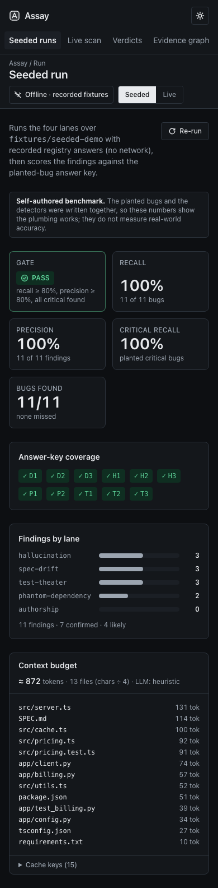 |
| Live scan |  | 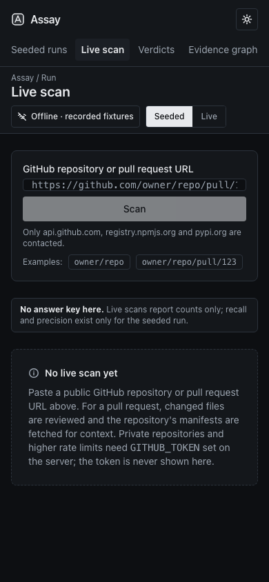 |
| Verdicts | 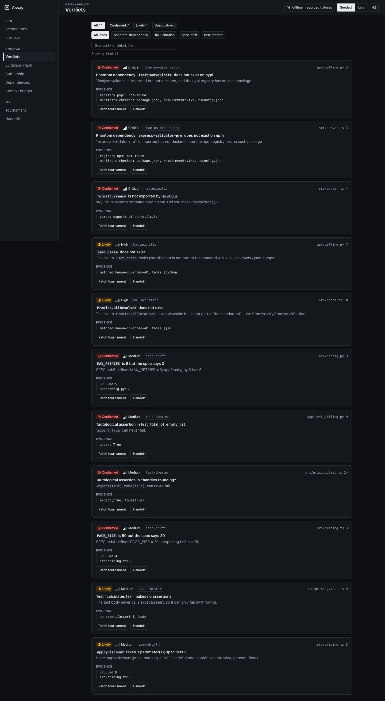 |  |
| Evidence graph | 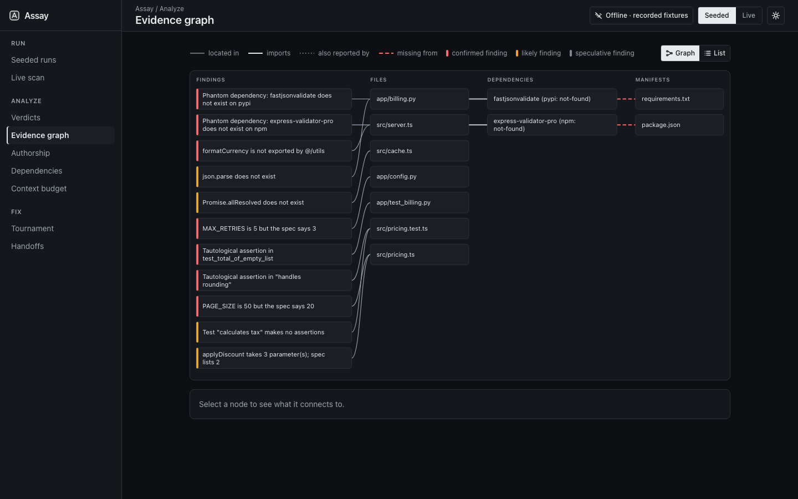 | 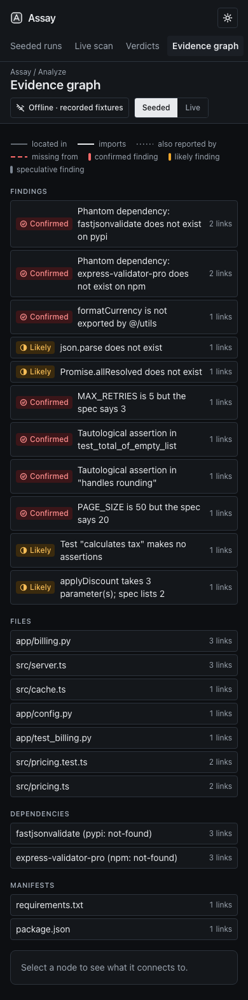 |
| Authorship |  | 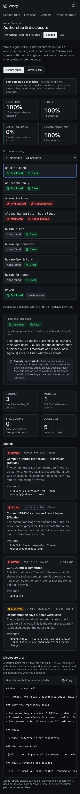 |
| Dependencies |  | 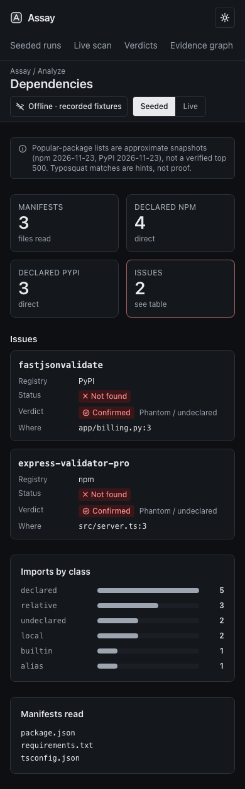 |
| Context budget |  | 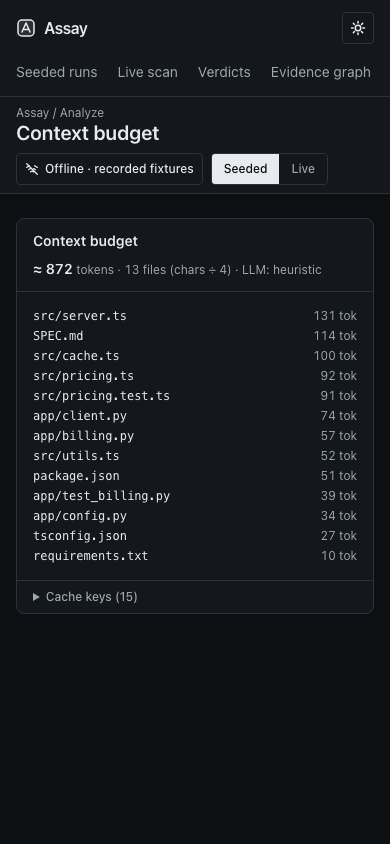 |
| Tournament | 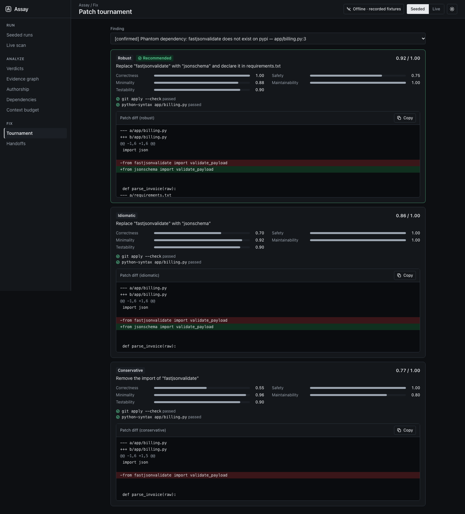 |  |
| Handoffs |  |  |

Light theme: [authorship](docs/screenshots/after/authorship-desktop-light.png), [evidence graph](docs/screenshots/after/graph-desktop-light.png), [verdicts](docs/screenshots/after/verdicts-desktop-light.png). The earlier UI and an audit of what was wrong with it are in `docs/screenshots/before/`.

## Architecture

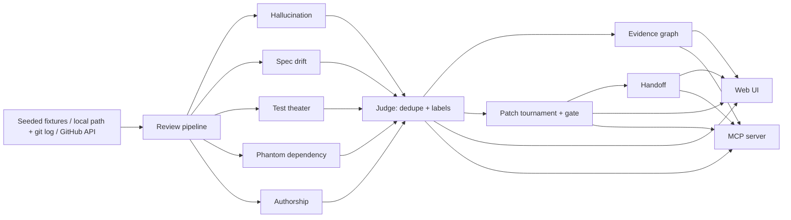

More detail, the module map and how to add a lane are in [docs/ARCHITECTURE.md](docs/ARCHITECTURE.md).

## Authorship & disclosure audit

The audit answers one question for a repository: *which signals of AI tool use does it contain, and is that disclosed?* It never says who or what wrote the code. Detection of AI-written code from style alone is unreliable, so style is treated as weak evidence and can never change the overall result.

| Strength | Signal | Examples |
|----------|--------|----------|
| Strong | Commit trailers and AI-tool authors | a `Co-Authored-By` line naming an AI tool, a "Generated with" line, a `Claude-Session`-style trailer, an author account such as `copilot-swe-agent[bot]` (dependency and CI bots are not counted) |
| Strong | Committed AI-tool files and folders | `CLAUDE.md`, `AGENTS.md`, `.cursorrules`, `.cursor/`, `.claude/`, `.github/copilot-instructions.md`, `.windsurfrules` |
| Moderate | README or docs statements about how the project was built | statements that AI tools were used, and statements that none were; checked against the other signals |
| Moderate / speculative | Commit-history shape | a burst of large commits within minutes (moderate); one very large initial commit, or one uniform message template (speculative) |
| Speculative | Code style | placeholder text, comment density, generic names, templated docstrings. Always shown with a false-positive caveat |

**Disclosure status**

| Status | Meaning |
|--------|---------|
| `disclosed` | AI-tool signals are present and the README says AI tools were used (a README statement with no detectable signals is also accepted: it is the owner's own account) |
| `undisclosed` | Strong signals are present and no disclosure was found |
| `mismatch` | The README claims no AI use, but strong signals exist |
| `none-found` | No strong signals. This is **not** proof of human authorship; tools can be used without leaving a trace |

The overall result is `clear`, `needs-review` or `action-needed`. Speculative signals never move it, and moderate evidence can reach `needs-review` but not `action-needed`.

**Disclosure helper.** For any report Assay drafts a "How this was built" README section. Every factual sentence in it comes from a strong or moderate signal (or from text you supply, labelled as yours), and it always leaves fill-in-the-blank sections for your own account. You edit it and decide what to publish.

**What it will not do.** There is no mode that removes, hides, rewrites or obfuscates authorship signals, rewrites commit history, or helps a repository pass as human-written; requests to do so are refused with an explanation (the module is read-only: a test asserts it only reads files and only runs `git log` and `git ls-files`). If a signal is a false positive, the right fix is to explain it in the README.

Use it from the **Authorship** view, `pnpm authorship <path>`, `GET /api/authorship?case=<fixture>`, or the MCP tool `assay_check_authorship`. Live GitHub scans read the tree and the commit history through the allowlisted client.

### Authorship benchmark (self-authored)

Nine small fixture repositories in `fixtures/authorship/` (AI tool use that is disclosed, undisclosed, a README that claims no AI use while `CLAUDE.md` is committed, mixed, AI use stated with no traces, a clean human-written repo, and three human-written repos built to trigger the false-positive style and history signals), with an answer key. `pnpm eval` reports:

```
strong+moderate signals: precision 100% (16 reported), recall 100% (16 expected)
status accuracy: 100%   overall-result accuracy: 100%
FPR on human-written fixtures: 0% (0/4)
speculative style/history signals on those fixtures: 6 (expected; weak; never change the result)
```

These fixtures and the detectors were written together, so the numbers show the plumbing works and that the false-positive guards behave as designed. They say nothing about how the audit performs on real repositories.

### The audit on Assay's own repository

Run with `pnpm authorship .` on this repository (31 commits, 208 tracked files, taken just before this README update was committed):

```
disclosure status: disclosed    overall: clear
No strong signals were found, but the documentation discloses AI use.
signals: 0 strong, 2 moderate, 1 speculative

[moderate]    Documentation says AI tools were used       README.md (the "How this was built" section)
[moderate]    8 large commits within 30 minutes            history caveat shown
[speculative] 4 placeholder phrases in code                false-positive caveat shown
```

What that does and does not say:

- **No strong signals.** The repository has no AI-tool trailers in its commit messages and no tool configuration files; the commits carry no attribution lines. If the README did not disclose anything, the audit would report `none-found`, which would tell a reader nothing about how the code was written. The only reason the status is `disclosed` is the statement in this README, which is my own account (see "How this was built" below). The audit could not have found it from the repository alone.
- **The burst of large commits** is real, and it has an ordinary explanation: each stage of the build plan was committed as one commit once its checks passed.
- **The placeholder phrases** are false positives of a weak heuristic. They are the audit's own pattern strings and fixture text (`TODO` inside regexes and fixture generators), which the style detector cannot tell from real placeholders.
- Running the audit on this repository also exposed two false positives in the detectors themselves (a sentence describing what the tool reviews, and documentation that discusses claims); both were fixed with tests (DECISIONS.md F44, F46).

## MCP client configuration

```json
{
  "mcpServers": {
    "assay": {
      "command": "pnpm",
      "args": ["--silent", "--dir", "/absolute/path/to/assay-app", "mcp"]
    }
  }
}
```

Tools: `assay_review`, `assay_fix`, `assay_score_patch`, `assay_handoff`, `assay_eval`, `assay_check_deps`, `assay_check_authorship`.
Resources: `assay://findings`, `assay://evidence-graph`, `assay://answer-key`. Prompts: `review`, `fix_handoff`.
`assay_review` returns a `scanId`; pass it to the other tools. Sources: `seeded` (bundled demo), `path` (local directory), `github` (repo or PR URL).

## How the Phantom Dependency lane works

1. **Parse imports** with line numbers: JS/TS (`import`, `import()`, `require`, `export … from`, `import type`) and Python (`import x`, `from x import y`; relative imports skipped). Specifiers are normalized to package names (`@scope/pkg/sub` → `@scope/pkg`, `lodash/fp` → `lodash`); Python import names map to distributions (`yaml` → `PyYAML`, `PIL` → `Pillow`, via a bundled table).
2. **Classify each import.** Treated as *declared*: Node builtins and `node:` imports, relative imports, tsconfig `paths`/`baseUrl` aliases and `#imports`, the package's own name, the Python standard library, and Python modules defined in the scanned repo.
3. **Resolve against manifests and lockfiles:** `package.json` (deps, dev, peer, optional), `pnpm-lock.yaml`, `package-lock.json`, `yarn.lock`; `requirements*.txt`, `pyproject.toml` (PEP 621 and Poetry), `Pipfile`, `poetry.lock`. Present in a manifest → fine. Present only in a lockfile → low-severity "transitive only". Neither → candidate phantom.
4. **Ask the registry** (`registry.npmjs.org`, `pypi.org`) with a disk cache (`.assay-cache/`, 24 h) or, offline, recorded fixtures (`fixtures/registry-responses/`) plus the popular-package snapshot. Offline lookups that no fixture answers are `unknown`, never guessed.
5. **Label:** registry 404 → **confirmed** phantom (critical). Exception: a scoped package (`@scope/x`) or a project configured with a custom registry → **likely**, because the registry we can reach may not be the one that serves it. Exists but undeclared → likely (medium). Status unknown → speculative.
6. **Typosquats:** a name that is not itself in the popular list, ≥ 4 characters, within Damerau-Levenshtein distance 2 of a popular name (scoped names compared on the full name). Nonexistent → confirmed; existing lookalike → likely.

Findings carry file, line, specifier and registry status, and feed the evidence graph (finding → file → dependency → manifests it is missing from).

## Patch tournament and gate

For a finding, generators propose candidates (for bad imports: remove, replace, replace and declare, or declare). Each candidate is applied with `git apply` to a **copy** in a temp dir; one that doesn't apply, touches paths outside the tree, or fails a check (JSON validity, Python syntax) is **ineligible** and scores 0. Check subprocesses get an allowlisted environment: no variable whose name matches `KEY|TOKEN|SECRET|PASSWORD|…` ever reaches them (tested). Eligible patches are scored 0–1 on correctness (the review is re-run on the patched tree), minimality, safety, maintainability and testability.

## Honest limitations

- **Both benchmarks are self-authored.** The 11 planted bugs in `fixtures/seeded-demo` and the 9 authorship fixtures were written together with the detectors, so a perfect score shows the plumbing works end to end. It does **not** measure real-world accuracy. Live scans report no recall or precision because there is no ground truth.
- **The authorship audit reports signals, not verdicts.** Style-based detection of AI-written code is unreliable: speculative signals are shown with a false-positive caveat and never change the result. History shape has many innocent explanations. No strong signals is not evidence of human authorship, and strong signals say a tool was set up or named, not how much code it wrote. Anyone can remove traces; Assay does not try to catch that.
- Live GitHub scans read at most 200 commits and fetch line statistics only for the root commit, so the burst-of-large-commits signal cannot fire on them. Unauthenticated GitHub allows 60 requests per hour.
- Lanes are regex/heuristic based, not full parsers or type checkers. Expect misses and false positives on real code. Spec drift only understands a simple convention (`` `NAME` = `value` `` and `` `fn(a, b)` `` in markdown specs). README statement detection is phrase-based and English-only.
- **Popular-package lists are approximate snapshots** (curated by hand, about 480 npm / 340 PyPI names), not a verified top 500. Typosquat hints depend on them. `scripts/refresh-popular.ts` refreshes npm from the registry search endpoint; PyPI has no ranking endpoint on an allowed host, so it needs `--pypi-file`.
- Gate checks only use tooling that needs no install (apply, JSON, Python syntax). Your project's own test suite is not run.
- Replacement package names for phantom imports come from a small curated table; the replacement's API is not verified.

See `DECISIONS.md` for every default chosen and why.

## How this was built

This project was built with Claude Code, an AI coding assistant, used interactively in a terminal and editor session. This section started as a draft from Assay's own disclosure helper, based on the audit above and my declaration; I keep it accurate by editing it.

### What the repository shows

An audit of this repository finds no strong signals: no AI-tool trailers in the commit messages and no tool configuration files are committed. That is why this section exists. The absence of signals shows nothing about how the code was written.

### Tools

- Claude Code, used interactively in a terminal and editor session (declared by me, not detected).

### What was assisted

- Most of the implementation, the tests, the UI and the documentation were written with the assistant from my specifications, in stages that I approved one at a time.

### What I reviewed and decided

_[Owner to fill in: what you read, tested, changed or rejected yourself, and who is accountable for the final code.]_

### Worth explaining

- The history shows bursts of large commits. Each stage of the plan was committed as one commit once its checks passed.

### In my own words

_[Owner to fill in: anything else readers should know about how you worked.]_

## Acknowledgements

Inspired by the public Scout project. <!-- TODO(owner): add the link to that project here -->

## License and contributing

MIT, see [LICENSE](LICENSE). Contributions: see [CONTRIBUTING.md](CONTRIBUTING.md).
