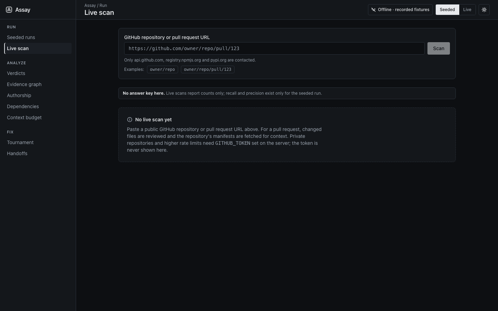
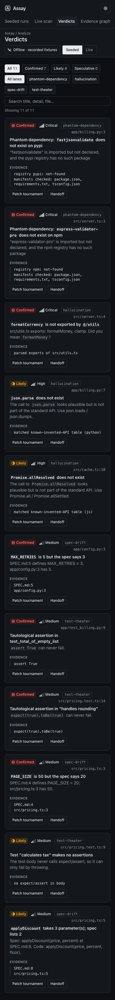
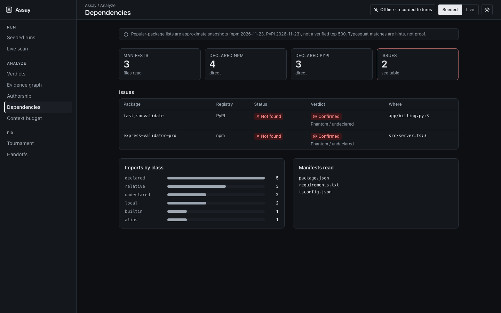
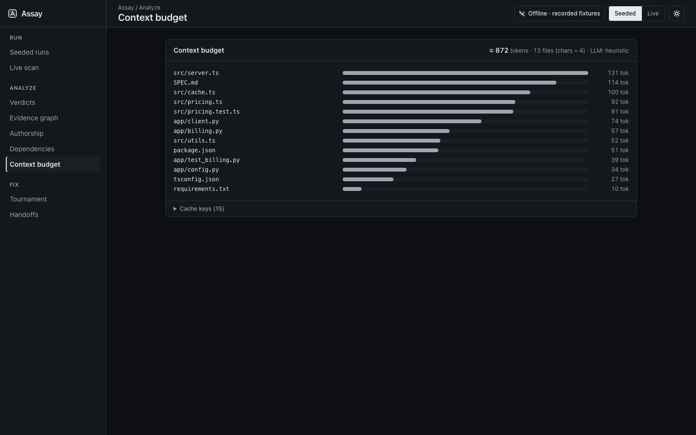
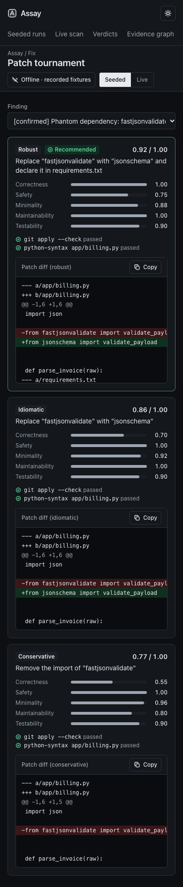
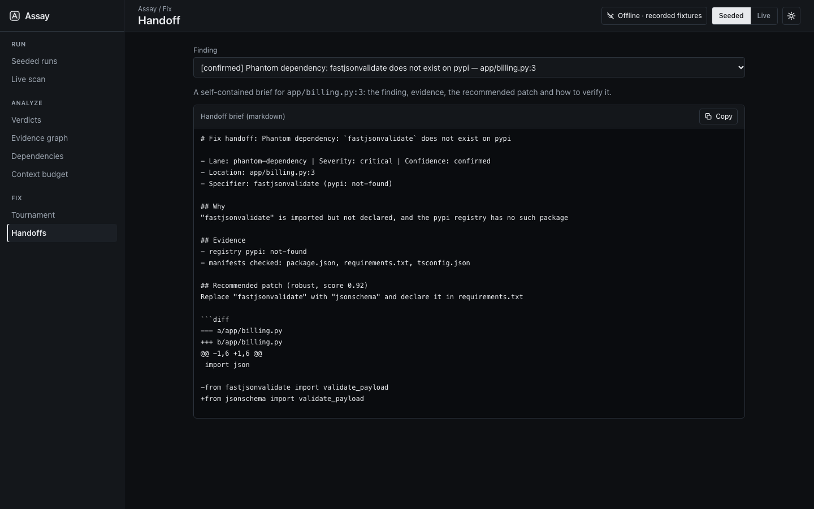
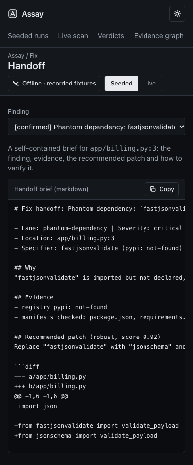

# Assay

Assay reviews AI-written code in four lanes and reports each finding as **confirmed**, **likely** or **speculative**:

| Lane | Looks for |
|------|-----------|
| Hallucination | Invented stdlib/builtin APIs, named imports a local module doesn't export, imports of missing files |
| Spec drift | Constants and function signatures that disagree with `SPEC.md`-style docs |
| Test theater | Tests with no assertions, tautologies (`expect(true).toBe(true)`, `assert True`), skipped tests, tests that mock the unit under test |
| Phantom dependency | Imports that no manifest declares, packages that don't exist on npm/PyPI, typosquats |

It can then run a **patch tournament**: candidate fixes are applied to a copy of the tree in a temp dir (the *gate*), re-reviewed, and scored on five axes. Everything is available in a web UI and over MCP.

## Setup

```bash
pnpm install            # pnpm 8.9.2 works with Next 16 / React 19
pnpm test               # no network, no API key needed
pnpm build              # same
pnpm eval               # seeded benchmark: recall, precision, critical recall, gate
pnpm dev                # UI at http://localhost:3000
pnpm mcp                # MCP server on stdio
```

Optional environment variables (see `.env.example`; never logged):

| Var | Purpose |
|-----|---------|
| `GITHUB_TOKEN` | Higher rate limits / private repos for live scans. Sent only to `api.github.com`. |
| `ASSAY_OFFLINE=1` | Skip live registry lookups for local/GitHub scans (recorded fixtures and cache only). |

### Offline verification

`pnpm test`, `pnpm build`, `pnpm eval` and `pnpm e2e` pass with outbound network blocked (checked with a macOS `sandbox-exec` profile that allows loopback only; see DECISIONS.md F29). A test-side guard fails any test that tries a real `fetch`.

### Network policy

Data fetching goes through one allowlist (`src/core/allowlist.ts`): `api.github.com`, `registry.npmjs.org`, `pypi.org`, https only, redirects re-checked. Anything else is rejected (tested). The allowlist is absolute: there is no exception, and no model API is contacted. Findings come from deterministic heuristics only.

## MCP client configuration

```json
{
  "mcpServers": {
    "assay": {
      "command": "pnpm",
      "args": ["--silent", "--dir", "/absolute/path/to/assay-app", "mcp"]
    }
  }
}
```

Tools: `assay_review`, `assay_fix`, `assay_score_patch`, `assay_handoff`, `assay_eval`, `assay_check_deps`.
Resources: `assay://findings`, `assay://evidence-graph`, `assay://answer-key`. Prompts: `review`, `fix_handoff`.
`assay_review` returns a `scanId`; pass it to the other tools. Sources: `seeded` (bundled demo), `path` (local directory), `github` (repo or PR URL).

## How the Phantom Dependency lane works

1. **Parse imports** with line numbers: JS/TS (`import`, `import()`, `require`, `export … from`, `import type`) and Python (`import x`, `from x import y`; relative imports skipped). Specifiers are normalized to package names (`@scope/pkg/sub` → `@scope/pkg`, `lodash/fp` → `lodash`); Python import names map to distributions (`yaml` → `PyYAML`, `PIL` → `Pillow`, via a bundled table).
2. **Classify each import.** Treated as *declared*: Node builtins and `node:` imports, relative imports, tsconfig `paths`/`baseUrl` aliases and `#imports`, the package's own name, the Python standard library, and Python modules defined in the scanned repo.
3. **Resolve against manifests and lockfiles:** `package.json` (deps, dev, peer, optional), `pnpm-lock.yaml`, `package-lock.json`, `yarn.lock`; `requirements*.txt`, `pyproject.toml` (PEP 621 and Poetry), `Pipfile`, `poetry.lock`. Present in a manifest → fine. Present only in a lockfile → low-severity "transitive only". Neither → candidate phantom.
4. **Ask the registry** (`registry.npmjs.org`, `pypi.org`) with a disk cache (`.assay-cache/`, 24 h) or, offline, recorded fixtures (`fixtures/registry-responses/`) plus the popular-package snapshot. Offline lookups that no fixture answers are `unknown`, never guessed.
5. **Label:** registry 404 → **confirmed** phantom (critical). Exception: a scoped package (`@scope/x`) or a project configured with a custom registry (`.npmrc` registry, extra PyPI index, Poetry/Pipfile source) → **likely**, because the registry we can reach may not be the one that serves it. Exists but undeclared → likely (medium). Status unknown → speculative.
6. **Typosquats:** a name that is not itself in the popular list, ≥ 4 characters, within Damerau-Levenshtein distance 2 of a popular name (scoped names compared on the full name). Nonexistent → confirmed; existing lookalike → likely.

Findings carry file, line, specifier and registry status, and feed the evidence graph (finding → file → dependency → manifests it is missing from).

## Patch tournament and gate

For a finding, generators propose candidates (for bad imports: remove, replace, replace and declare, or declare). Each candidate is applied with `git apply` to a **copy** in a temp dir; one that doesn't apply, touches paths outside the tree, or fails a check (JSON validity, Python syntax) is **ineligible** and scores 0. Check subprocesses get an allowlisted environment: no variable whose name matches `KEY|TOKEN|SECRET|PASSWORD|…` ever reaches them (tested). Eligible patches are scored 0–1 on correctness (the review is re-run on the patched tree), minimality, safety, maintainability and testability.

## UI

A left-nav app shell (Run: Seeded runs, Live scan · Analyze: Verdicts, Evidence graph, Dependencies, Context budget · Fix: Tournament, Handoffs) with a top bar showing the offline/online status, a Seeded/Live source switch and a light/dark toggle (first load follows your OS setting). Every view has loading, empty and error states; every finding shows its label, severity, file:line and evidence; diffs and handoffs have copy buttons. The UI makes no network requests other than to its own API routes and uses system fonts only.

| View | Desktop (1440px) | Mobile (390px) |
|------|------------------|----------------|
| Seeded runs |  |  |
| Live scan |  |  |
| Verdicts |  |  |
| Evidence graph |  |  |
| Dependencies |  |  |
| Context budget |  |  |
| Tournament |  |  |
| Handoffs |  |  |

Light theme: [evidence graph](docs/screenshots/after/graph-desktop-light.png), [verdicts](docs/screenshots/after/verdicts-desktop-light.png). The earlier UI and an audit of what was wrong with it are in `docs/screenshots/before/`.

### UI tests

```bash
pnpm test                                   # includes Testing Library component/view tests and a contrast check of the design tokens
pnpm exec playwright install chromium       # once
pnpm build && pnpm e2e                      # Playwright smoke (no console errors in any view, desktop + mobile), keyboard, theme, error-scrubbing, and axe WCAG 2.1 A/AA scans in both themes
pnpm build && pnpm start -p 3111 &          # then: pnpm screenshots docs/screenshots/after [dark|light]
```

## Honest limitations

- **The seeded benchmark is self-authored.** The 11 planted bugs in `fixtures/seeded-demo` and the detectors were written together, so a 100% score shows the plumbing works end to end. It does **not** measure real-world accuracy. Live scans deliberately report no recall/precision because there is no ground truth.
- Lanes are regex/heuristic based, not full parsers or type checkers. Expect misses and false positives on real code. Spec drift only understands a simple convention (`` `NAME` = `value` `` and `` `fn(a, b)` `` in markdown specs).
- **Popular-package lists are approximate snapshots** (hand-curated, about 480 npm / 340 PyPI names), not a verified top 500. Typosquat hints depend on them. `scripts/refresh-popular.ts` refreshes npm from the registry search endpoint; PyPI has no ranking endpoint on an allowed host, so it needs `--pypi-file`.
- Gate checks only use tooling that needs no install (apply, JSON, Python syntax). Your project's own test suite is not run.
- Replacement package names for phantom imports come from a small curated table; the replacement's API is not verified.

See `DECISIONS.md` for every default chosen and why.
