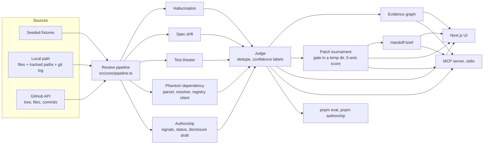

# Architecture

Assay reviews a codebase with five independent lanes, merges what they find, and presents it three ways (web UI, MCP server, CLI). Everything runs locally; the only network access is to `api.github.com`, `registry.npmjs.org` and `pypi.org`, through one allowlist.

## Layout

| Path | Responsibility |
|------|----------------|
| `src/core/` | Zod types, pipeline, scan service (UI and MCP share it), host allowlist, file loading |
| `src/lanes/` | One module per lane; each returns `Finding[]` |
| `src/deps/` | Import parser, manifest/lockfile resolver, registry client (cache, offline fixtures), typosquat matcher |
| `src/authorship/` | Signal detectors, disclosure status, disclosure draft, refusal policy, fixtures eval, read-only git access |
| `src/judge/` | Dedupe and labels; seeded bug eval |
| `src/graph/` | Evidence graph (findings, files, dependencies, manifests, commits) |
| `src/patches/`, `src/gate/` | Candidate patches, scoring, temp-dir gate with a sanitised environment |
| `src/github/` | Allowlisted GitHub client: tree, files, commits, rate-limit-aware errors |
| `src/mcp/` | MCP server (tools, resources, prompts) |
| `src/app/` | Next.js App Router UI: shell, views, components, API routes |
| `fixtures/` | Seeded demo repo and answer key, authorship fixtures and answer key, registry responses, popular-package snapshots |
| `e2e/`, `tests/` | Playwright smoke and accessibility scans; Vitest unit, integration and UI tests |

## Findings and labels

Every lane emits `Finding`s with a label: `confirmed` (a checkable fact), `likely` (strong circumstantial evidence), `speculative` (weak). The judge merges findings that point at the same place and upgrades `likely` to `confirmed` only when two lanes independently agree. For the authorship lane the label follows signal strength (strong, moderate, speculative), and a speculative signal can never change the overall result.

## Trust boundaries

- **Network:** one allowlist, https only, redirects re-checked. Tokens go only to `api.github.com` and never appear in error messages.
- **Patch gate:** candidate diffs are applied to a copy in a temp dir with an allowlisted environment (no variable whose name looks like a credential).
- **Authorship audit:** read-only by construction (a test asserts only read-only `fs` calls and only `git log` / `git ls-files`), and a policy check refuses requests to conceal signals.

## Testing layers

Unit tests per detector and lane; fixtures with answer keys for both evals; Testing Library tests for components and views; Playwright smoke (no console errors, keyboard, theme) and axe scans for WCAG 2.1 A/AA in both themes. The whole suite passes with outbound network blocked.

## Adding things

- **A lane:** write `(ctx) => Finding[]`, register it in `src/core/pipeline.ts`, add the lane to `LaneSchema`, and give it fixtures.
- **An authorship signal:** add a detector in `src/authorship/detect.ts` with a strength and explanation (and a caveat if weak), a positive fixture and a human-written fixture that shows how it can misfire, then update `scripts/build-authorship-fixtures.ts`.
